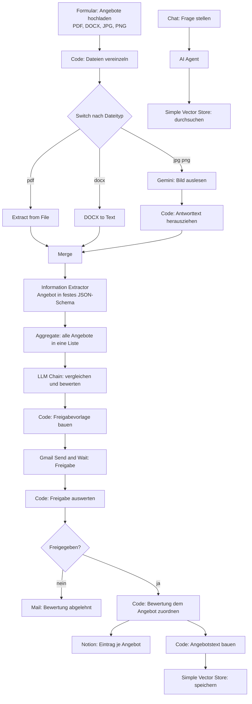

# Angebotsanalyse mit KI

Ein n8n-Workflow, der eingehende Angebote in verschiedenen Dateiformaten ausliest, in eine einheitliche Struktur bringt, miteinander vergleicht, die Bewertung einem Menschen zur Freigabe vorlegt und erst danach ablegt. Entstanden im Rahmen der Weiterbildung zum KI-Integrationsmanager (IHK).

---

## 1. Kurzbeschreibung

Wer eine Leistung ausschreibt, bekommt die Angebote in allem, was es gibt: als PDF, als Word-Datei, als abfotografiertes Blatt Papier. Um sie zu vergleichen, muss man sie zuerst von Hand in eine gemeinsame Form bringen, und das ist der Teil, der Zeit kostet und bei dem Fehler entstehen.

Schwieriger als der Preisvergleich ist dabei der Leistungsvergleich. Zwei Angebote mit ähnlicher Summe können einen völlig unterschiedlichen Umfang haben, weil das eine Material enthält und das andere nicht, oder weil eine Position schlicht fehlt. Genau das übersieht man beim Überfliegen, und genau das wird später teuer.

Der Workflow nimmt beide Schritte ab. Er liest jedes Angebot aus, egal in welchem Format es ankommt, überführt es in ein festes Schema mit vereinheitlichten Leistungsbezeichnungen, und lässt anschließend ein Modell alle Angebote gegeneinander bewerten. Die Bewertung benennt ausdrücklich fehlende Angaben und weist darauf hin, wenn Angebote gar nicht sinnvoll vergleichbar sind. Das Ergebnis geht an eine zuständige Person zur Freigabe und wird erst nach deren Zustimmung abgelegt.

---

## 2. Ziel und Nutzen

| Größe | Vorher | Nachher |
|---|---|---|
| **Zeit** | Angebote einzeln lesen, Positionen abtippen, Summen vergleichen | Hochladen, prüfen, freigeben. Die Auswertung von drei Angebotsdateien dauert im Test unter einer Minute |
| **Qualität** | Der Vergleich hängt davon ab, wie aufmerksam jemand an diesem Tag liest | Jedes Angebot wird nach demselben Schema zerlegt, und jede Position bekommt eine vereinheitlichte Vergleichsbezeichnung |
| **Fehlerquote** | Fehlende Angaben fallen oft erst auf, wenn die Rechnung kommt | Fehlende Angaben werden ausdrücklich benannt, nicht stillschweigend übergangen |
| **Nachvollziehbarkeit** | Die Entscheidungsgrundlage steckt in einem Mailverlauf oder gar nur im Kopf | Jede Bewertung liegt mit Begründung in Notion, und es ist belegt, wer sie freigegeben hat |
| **Gedächtnis** | Nach dem Vergleich ist das Wissen weg | Alle ausgewerteten Angebote bleiben durchsuchbar, auch über Monate hinweg |

Der wirtschaftliche Kern liegt nicht im eingesparten Lesen, sondern in den vermiedenen Nachträgen. Ein übersehener Satz wie „ohne Fliesenarbeiten" kostet im Bau mehr als die gesamte Bearbeitungszeit aller Angebote zusammen.

---

## 3. Beschreibung der Erweiterung

Der ursprüngliche Workflow endete beim Schreiben nach Notion. Zwei Erweiterungen sind hinzugekommen.

### Erweiterung 1: Gedächtnis über alle Angebote, mit einem Vector Store

**Was fehlte.** Der Workflow betrachtete immer nur die Angebote eines Uploads. Was im Vormonat ausgewertet wurde, war für ihn nicht vorhanden. Fragen wie „Hat dieser Anbieter schon einmal für uns kalkuliert?" ließen sich nicht beantworten.

**Was ergänzt wurde.** Jedes ausgewertete Angebot wird zusätzlich in einem **Simple Vector Store** abgelegt. Dafür baut ein Code-Knoten aus den Einzelfeldern einen zusammenhängenden Text, der Default Data Loader zerlegt ihn in Abschnitte, und ein lokales Embedding-Modell wandelt jeden Abschnitt in einen Zahlenvektor um. Ein zweiter, eigenständiger Teil stellt einen Chat zur Verfügung, in dem ein KI-Agent diesen Speicher durchsuchen kann.

**Warum ein Vector Store und nicht eine Volltextsuche.** Eine Stichwortsuche findet nur, was wörtlich dasteht. Die Suche über Embeddings vergleicht Bedeutungen. Im Test wurde gefragt, bei welchen Angeboten das Risiko besteht, dass später Kosten dazukommen. Weder „Risiko" noch „dazukommen" steht in einem der Angebote. Gefunden wurden trotzdem beide richtigen Treffer, nämlich „Materialkosten können variieren" und „ohne Fliesenarbeiten". Eine Volltextsuche hätte nichts geliefert.

### Erweiterung 2: Menschliche Freigabe vor der Ablage

**Was fehlte.** Die Bewertung des Modells ging ungeprüft nach Notion. Damit stand eine maschinell erzeugte Empfehlung mit Rangfolge in der Ablage, auf die sich später jemand beruft.

**Was ergänzt wurde.** Zwischen Bewertung und Ablage steht jetzt ein **Gmail-Knoten im Modus Send and Wait**. Er legt der zuständigen Person den vollständigen Vergleich vor und hält den Workflow an. Erst nach ausdrücklicher Zustimmung wird abgelegt. Bei Ablehnung geht eine Mail mit Begründung zurück, und weder Notion noch der Vector Store werden beschrieben.

**Warum vor und nicht nach der Aufteilung.** Die Freigabe sitzt vor dem Knoten, der den Vergleich in einzelne Angebote zerlegt. Dadurch gibt es eine Freigabe je Vergleich und nicht eine je Angebot, und beide Ablagen liegen hinter demselben Tor. Ein nicht freigegebener Vergleich soll auch nicht im Gedächtnis landen.

---

## 4. Ablauf des Workflows



<!-- BILD 1: Gesamtansicht des Workflows in n8n, mit den beiden farbigen Bereichen --> 

*Der Workflow in n8n. Der gelbe Bereich ist der ursprüngliche Ablauf, der violette Bereich speichert jedes Angebot im Vector Store, der untere Bereich ist der Chat-Assistent.*

**1. Daten empfangen.** Ein Webformular nimmt die Angebote entgegen und akzeptiert PDF, DOCX, JPG und PNG. Mehrere Dateien in einem Durchgang sind möglich, denn nur dann gibt es überhaupt etwas zu vergleichen.

**2. Vereinzeln.** Der erste Code-Knoten löst die hochgeladenen Dateien aus dem gemeinsamen Element heraus und erzeugt je Datei ein eigenes mit Dateiname, MIME-Typ und Dateiendung. Erst danach kann jede Datei ihren eigenen Weg nehmen.

**3. Verzweigung nach Format.** Der Switch schickt jede Datei auf einen von drei Wegen. PDF geht an die Textextraktion, DOCX an den Konverter, Bilddateien an Gemini. Für Bilder gibt es keinen regelbasierten Weg, weil ein Foto keinen Text enthält, den man herauslösen könnte.

**4. Bilder auslesen.** Gemini bekommt das Bild und die Anweisung, den vollständigen Text zu übernehmen und nichts zu ergänzen. Ein zweiter Code-Knoten holt den Text aus der verschachtelten Antwortstruktur, damit er dieselbe Form hat wie die beiden anderen Wege.

**5. Zusammenführen.** Der Merge-Knoten mit drei Eingängen bringt die Wege wieder zusammen. Ab hier ist jedes Angebot nur noch Text, unabhängig davon, woher es kam.

**6. Strukturieren.** Der Information Extractor überführt jedes Angebot in ein selbst geschriebenes JSON-Schema mit Anbieter, Angebotsdatum, Projekt, einer Liste von Leistungen mit Einzelpreisen, Gesamtpreis, Währung, Ausführungszeitraum und Hinweisen. Jede Leistung bekommt zusätzlich eine vereinheitlichte Vergleichsbezeichnung. Der Systemprompt verbietet das Erfinden von Angaben und schreibt `null` vor, wo etwas fehlt.

**7. Bewerten.** Aggregate bündelt alle Angebote zu einer Liste, und eine LLM Chain vergleicht sie gegeneinander. Die Regeln im Prompt halten fest, dass ein niedriger Preis allein keine Empfehlung rechtfertigt und dass fehlende Vergleichbarkeit benannt werden muss. Jedes Angebot erhält Status, Rang, Stärken, Schwächen, Auffälligkeiten und eine Begründung.

**8. Freigabe.** Ein Code-Knoten macht aus der Bewertung eine lesbare Vorlage. Der Gmail-Knoten schickt sie an die zuständige Person und hält den Workflow an. Das Antwortformular kennt drei Entscheidungen: freigeben, mit Anmerkung freigeben, ablehnen.

**9. Auswerten der Freigabe.** Der auswertende Code-Knoten setzt `ablehnen` als Vorgabewert, bevor er die Antwort überhaupt liest. Bleibt die Antwort aus oder kommt etwas Unverständliches zurück, gilt der Vergleich als abgelehnt.

**10. Ablegen.** Nach Zustimmung führt ein Code-Knoten jedes Angebot mit seiner Bewertung zusammen. Von dort laufen zwei Zweige: Notion legt je Angebot einen Datenbankeintrag an, und der Vector Store speichert den Angebotstext als Embeddings.

**11. Durchsuchen.** Ein eigenständiger Teil mit Chat Trigger und AI Agent nutzt den Vector Store als Werkzeug und beantwortet Fragen über alle gespeicherten Angebote hinweg.

---

## 5. Tools und KI-Modelle

| Baustein | Eingesetzt wofür | Warum dieses und kein anderes |
|---|---|---|
| **n8n**, lokal in Docker | Ablaufsteuerung, alle Knoten | Verbindet Upload, Modellaufruf, Regeln, Mail und Datenbank ohne eigene Anwendung |
| **Formular-Trigger** | Eingang der Angebote | Kein Postfach nötig, keine Anmeldung für den Einreichenden |
| **Extract from File** | Text aus PDF | Standardknoten, kein Modellaufruf nötig, wo Text bereits vorliegt |
| **n8n-nodes-docx-converter** | Text aus Word | Community-Node, n8n hat dafür keinen Standardknoten |
| **Google Gemini** `gemini-3.1-flash-lite` | gescannte und fotografierte Angebote lesen | Multimodal, liest Text direkt aus dem Bild. Die kleine Variante genügt, weil nur abgeschrieben und nicht interpretiert wird |
| **Groq** `openai/gpt-oss-120b` | Extraktion in das Schema und Bewertung | Siehe Begründung unten |
| **Information Extractor** und **Structured Output Parser** | Schema erzwingen | Ein Modell hält ein Format nicht ein, weil man es im Prompt beschreibt. Der Parser erzwingt es und löst bei Abweichung einen neuen Versuch aus |
| **Gmail**, Send and Wait | Freigabe | Hält den Workflow an, bis ein Mensch entschieden hat. Kein zusätzliches Werkzeug nötig, die Entscheidung passiert dort, wo die Zuständigen ohnehin arbeiten |
| **Ollama** `qwen3-embedding:0.6b` | Embeddings für den Vector Store | Läuft lokal, Angebotsinhalte verlassen den Rechner für diesen Schritt nicht. Mit 0,6 Mrd. Parametern klein und schnell genug für laufenden Betrieb |
| **Ollama** `gemma4:latest` | Sprachmodell des Chat-Agenten | Läuft lokal auf der Grafikkarte. Die Fragen im Chat sind kurz, die Kontextmenge gering, dafür genügt ein lokales Modell |
| **Simple Vector Store** | Speicher der Embeddings | Für den Prototyp vorgesehen. Siehe Einschränkung unter Risiken |
| **Notion** | Ablage der Bewertungen | Bereits im Unternehmen vorhanden, Tabellenansicht ohne eigene Entwicklung |

### Warum Groq und nicht das lokale Modell für die Auswertung

Beide Auswertungsknoten liefen zunächst versuchsweise auf dem lokalen `gemma4`. Bei zehn Angeboten in einem Durchlauf brach der Structured Output Parser mit der Meldung ab, das Modell habe eine leere Antwort geliefert. Ursache ist das begrenzte Kontextfenster: Zehn Angebote plus das verschachtelte Bewertungsschema passen nicht hinein, und am Ende bleibt kein Platz mehr für die Antwort.

Für Extraktion und Vergleich steht deshalb ein großes Modell über Groq dahinter. Diese beiden Schritte brauchen langen Kontext und zuverlässige strukturierte Ausgabe, und genau darin liegt der Unterschied zwischen einem 120-Milliarden- und einem 8-Milliarden-Modell.

Die Modellwahl ist damit eine bewusst gemischte: lokal, wo es reicht, extern, wo es nötig ist. Welche Daten dabei wohin gehen, steht im nächsten Abschnitt.

---

## 6. Daten

### Was verarbeitet wird

| Datenart | Beispiel | Wohin sie geht |
|---|---|---|
| Angebotsdateien | PDF, DOCX, Foto | lokal in n8n |
| Angebotstext | Leistungen, Preise, Fristen, Hinweise | Groq (USA) zur Extraktion und Bewertung |
| Bildinhalt gescannter Angebote | Foto des Angebots | Google Gemini (USA) zum Auslesen |
| Strukturierte Angebotsdaten | Anbieter, Preise, Bewertung | Notion und lokaler Vector Store |
| Freigabeentscheidung | Entscheidung, Anmerkung, Zeitpunkt | Gmail und Notion |

### Personenbezug

**In der aktuellen Testumgebung: nein.** Alle Testangebote sind frei erfunden. Die Anbieter heißen Elektro Meier GmbH, Schmidt Sanitärtechnik und Bau & Trockenbau AG, es gibt diese Unternehmen nicht, und es stehen keine Ansprechpartner, Telefonnummern oder Adressen darin.

**Im echten Einsatz: ja.** Ein reales Angebot enthält regelmäßig den Namen und die Kontaktdaten eines Ansprechpartners, also personenbezogene Daten im Sinne von Art. 4 Nr. 1 DSGVO. Dazu kommen Geschäftsgeheimnisse des anbietenden Unternehmens, nämlich Kalkulation und Preisgestaltung, die zwar nicht personenbezogen, aber vertraulich sind.

Die Freigabeentscheidung ist ebenfalls personenbezogen, denn sie lässt sich der zuständigen Person zuordnen. Das ist beabsichtigt, weil die Nachvollziehbarkeit der Entscheidung ihr Zweck ist, hat aber Folgen für die Mitbestimmung (siehe Abschnitt 8).

**Besondere Kategorien nach Art. 9 DSGVO fallen nicht an.**

---

## 7. Integration im Unternehmen

### Technische Voraussetzungen

| Voraussetzung | Anmerkung |
|---|---|
| n8n, selbst betrieben | Docker-Container, erreichbar für die Beteiligten |
| Community-Node `n8n-nodes-docx-converter` | Nachinstallation über Settings, Community Nodes |
| Ollama auf demselben Host | mit `gemma4` und `qwen3-embedding:0.6b` |
| Erreichbarkeit aus dem Container | `http://host.docker.internal:11434`, nicht `localhost` |
| Groq-Zugang | API-Schlüssel, in n8n-Credentials hinterlegt |
| Google-Zugang | Gemini-API und Gmail über OAuth |
| Notion | Integrationstoken und eine Datenbank mit den passenden Spalten |

### Organisatorische Voraussetzungen

| Rolle | Zuständigkeit |
|---|---|
| **Einkauf oder Projektleitung** | fachliche Freigabe jedes Vergleichs, Pflege der Bewertungsregeln im Prompt |
| **IT-Betrieb** | Betrieb des n8n-Containers, Sicherung, Aktualisierung der Zugänge |
| **Datenschutzbeauftragte Person** | Freigabe der Verarbeitungstätigkeit, Prüfung der Auftragsverarbeitung |
| **Fachliche Verantwortung für das Ergebnis** | bleibt bei der Person, die freigibt, nicht beim System |

### Ein Betriebspunkt, der leicht übersehen wird

Der Workflow hängt am Google-Zugang einer einzelnen Person. Steht der OAuth-Zustimmungsbildschirm des Google-Projekts auf *Testen*, laufen die Zugangstoken nach sieben Tagen ab, und der Workflow bleibt mit einer Fehlermeldung stehen. Das ist im Test aufgetreten.

Im Unternehmen gehört dafür ein **Dienstkonto** eingerichtet und kein persönliches Konto, damit der Workflow weiterläuft, wenn jemand die Rolle wechselt oder das Unternehmen verlässt. Die Freigabeadresse sollte ebenfalls ein Funktionspostfach sein und kein persönliches.

---

## 8. Governance und Compliance

### Datenschutz

**Rechtsgrundlage.** Die Verarbeitung der Angebotsdaten stützt sich auf Art. 6 Abs. 1 lit. b DSGVO, soweit sie der Anbahnung eines Vertrags dient, im Übrigen auf das berechtigte Interesse nach Art. 6 Abs. 1 lit. f DSGVO an einer wirtschaftlichen Beschaffung.

**Auftragsverarbeitung.** Groq und Google verarbeiten Angebotsinhalte im Auftrag. Dafür ist jeweils ein Vertrag nach Art. 28 DSGVO erforderlich. Vor einem produktiven Einsatz ist zu prüfen, ob die kostenfreien Kontingente, die hier verwendet werden, einen solchen Vertrag überhaupt zulassen. Erfahrungsgemäß ist das bei Gratis-Kontingenten nicht der Fall, sodass ein kostenpflichtiger Tarif nötig wird.

**Drittlandübermittlung.** Beide Anbieter sitzen in den USA, es gilt Art. 44 ff. DSGVO. Als Grundlage kommt der EU-US Data Privacy Framework in Betracht, sofern der jeweilige Anbieter zertifiziert ist, andernfalls Standardvertragsklauseln mit Transfer Impact Assessment.

**Datenminimierung nach Art. 5 Abs. 1 lit. c.** Der Workflow schickt den vollständigen Angebotstext an das externe Modell. Angebote, die besonders schützenswerte Kalkulationsdaten enthalten, sollten über den lokalen Zweig laufen. Das ist technisch bereits angelegt, weil Embeddings und Chat lokal arbeiten.

**Löschung.** Notion-Einträge unterliegen den Aufbewahrungsfristen des Beschaffungsvorgangs. Der Vector Store ist flüchtig und damit unproblematisch, bei einem Wechsel auf eine dauerhafte Datenbank braucht es ein Löschkonzept.

### EU AI Act (VO (EU) 2024/1689)

**Rolle.** Das Unternehmen ist **Betreiber**, nicht Anbieter. Es setzt bestehende KI-Modelle ein und bringt kein eigenes System in Verkehr.

**Risikoeinstufung: begrenztes Risiko.** Der Anwendungsfall ist die Bewertung von Lieferantenangeboten. Anhang III nennt Beschäftigung, Bildung, Kreditwürdigkeit, wesentliche Dienste, Strafverfolgung, Migration und Justiz, aber nicht die Lieferantenauswahl eines privaten Unternehmens. Es liegt damit **kein Hochrisiko-System** vor.

**Transparenzpflichten nach Art. 50.** Der Chat-Assistent interagiert mit Beschäftigten. Dass sie mit einem KI-System sprechen, ist offensichtlich, sollte aber in der Arbeitsanweisung ausdrücklich stehen. Die Freigabemail weist ausdrücklich darauf hin, dass die Bewertung mit Unterstützung eines Sprachmodells erstellt wurde.

**KI-Kompetenz nach Art. 4.** Seit dem 2. Februar 2025 müssen Betreiber für ausreichende KI-Kompetenz der Personen sorgen, die mit dem System arbeiten. Die freigebenden Personen brauchen also eine Einweisung, die insbesondere erklärt, dass ein Sprachmodell plausibel klingende Zahlen erfinden kann.

### Urheberrecht

Angebote sind Werke der anbietenden Unternehmen. Sie werden ausschließlich zur Bewertung im Rahmen des Beschaffungsvorgangs verarbeitet, nicht veröffentlicht und nicht zum Training von Modellen verwendet. Bei externen Anbietern ist vertraglich sicherzustellen, dass übermittelte Inhalte nicht für Modelltraining genutzt werden. Das ist bei kostenfreien Kontingenten häufig nicht zugesichert und ein weiterer Grund für einen kostenpflichtigen Tarif.

### Mitbestimmung

Das System verarbeitet keine Leistungsdaten von Beschäftigten, und die Bewertung betrifft Lieferanten, nicht Mitarbeitende. Eine Mitbestimmung nach § 87 Abs. 1 Nr. 6 BetrVG wegen technischer Überwachungseinrichtungen kommt dennoch in Betracht, weil das Protokoll festhält, **wer wann welche Freigabe erteilt hat**. Diese Daten sind grundsätzlich geeignet, Verhalten und Leistung zu überwachen.

Der Betriebsrat ist deshalb vor dem produktiven Einsatz zu beteiligen. Eine Betriebsvereinbarung sollte festhalten, dass die Freigabeprotokolle ausschließlich dem Nachweis des Vorgangs dienen und nicht zur Leistungsbewertung einzelner Personen ausgewertet werden.

### Interne Richtlinien

Die Modellwahl folgt der Vorgabe, dass sensible Daten lokal verarbeitet werden. Zugangsdaten liegen ausschließlich in den n8n-Credentials und nie in Dateien oder im Repository.

---

## 9. Risiken und Gegenmaßnahmen

| Risiko | Art | Gegenmaßnahme |
|---|---|---|
| Das Modell erfindet eine Zahl, die im Angebot nicht steht | technisch | Der Prompt verbietet Rechnen und Ergänzen ausdrücklich und schreibt `null` vor, wo etwas fehlt. Die menschliche Freigabe sieht den Vergleich im Wortlaut vor der Ablage |
| Eine maschinelle Empfehlung wird ungeprüft zur Entscheidungsgrundlage | organisatorisch | Freigabe durch einen Menschen vor jeder Ablage. Ohne ausdrückliche Zustimmung wird nichts geschrieben |
| Ausbleibende Antwort wird als Zustimmung gewertet | technisch | Der auswertende Knoten setzt `ablehnen` als Vorgabewert, bevor er die Antwort liest |
| **Dubletten im Vector Store** | technisch | Im Test aufgetreten: Mehrfaches Ausführen legt dasselbe Angebot mehrfach ab, und der Assistent hält es für mehrere Vorgänge. Lösung bei dauerhaftem Einsatz: eindeutige Kennung je Angebot und eine Datenbank, die Dubletten erkennt |
| Verlust des Vector Store bei Neustart | technisch | Für den Prototyp hingenommen. Produktiv Wechsel auf eine dauerhafte Vector-Datenbank, etwa Supabase |
| Geschäftsgeheimnisse von Anbietern gehen an ein US-Modell | rechtlich | Auftragsverarbeitungsvertrag, Transfergrundlage, Ausschluss der Trainingsnutzung. Alternativ Umstellung des Bewertungsschritts auf ein lokales Modell, mit geringerer Qualität bei vielen Angeboten |
| Zugang läuft nach sieben Tagen ab | betrieblich | Im Test aufgetreten. OAuth-Projekt auf produktiven Status setzen, Dienstkonto statt persönlichem Konto |
| Abhängigkeit von einer einzelnen Person | organisatorisch | Funktionspostfächer, dokumentierte Einrichtung, Vertretungsregelung für die Freigabe |
| Eingescannte Angebote werden falsch gelesen | technisch | Der Prompt verlangt wortgetreue Übernahme. Die Freigabe sieht das Ergebnis, bevor es abgelegt wird. Bei schlechter Vorlage ist das Angebot neu anzufordern |
| Keine Vergleichbarkeit der Angebote | fachlich | Das Bewertungsschema enthält ein eigenes Feld `vergleichbarkeit`, und der Prompt verlangt ausdrücklich einen Hinweis, wenn Angebote nicht sinnvoll vergleichbar sind. Im Test hat das funktioniert |

---

## 10. Menschliche Kontrolle

**Freigabepflichtig ist die Ablage des Angebotsvergleichs.** Das ist die einzige Stelle mit Wirkung über den Workflow hinaus, denn ab dort ist die Bewertung für andere sichtbar und wird zur Entscheidungsgrundlage.

Die freigebende Person sieht vor ihrer Entscheidung:

- die Einschätzung zur Vergleichbarkeit der Angebote
- je Anbieter Status, Rang, Stärken, Schwächen, Auffälligkeiten und die Begründung
- das Gesamtfazit und die Empfehlung, oder den ausdrücklichen Hinweis, dass keine Empfehlung möglich ist
- den Hinweis, dass die Bewertung mit Unterstützung eines Sprachmodells erstellt wurde

Sie hat drei Möglichkeiten: freigeben, mit Anmerkung freigeben, ablehnen.

**Ohne ausdrückliche Zustimmung geschieht nichts.** Bleibt die Antwort aus, läuft die Frist ab oder kommt eine unverständliche Antwort zurück, gilt der Vergleich als abgelehnt. Der Vorgabewert steht im Code, bevor die Antwort überhaupt gelesen wird. Stillschweigen ist keine Zustimmung.

**Nicht freigabepflichtig** sind die Schritte davor, also Auslesen, Strukturieren und Bewerten. Sie haben keine Wirkung nach außen und können beliebig oft wiederholt werden.

Die fachliche Verantwortung für die Beschaffungsentscheidung bleibt beim Menschen. Der Workflow liefert eine Vorlage, keine Entscheidung.

---

## 11. Test und Erfolgsmessung

### Durchgeführte Tests

**Test 1, Auswertung und Freigabe.** Drei Angebote aus unterschiedlichen Gewerken, hochgeladen über das Formular.

Die Freigabevorlage wurde vollständig erzeugt:

```
VERGLEICH VON 3 ANGEBOTEN

Vergleichbarkeit: Die drei Angebote betreffen unterschiedliche Gewerke
(Elektro, Sanitär, Trockenbau) und decken daher nicht dieselben Leistungen ab.
Ein direkter Preis- und Leistungsvergleich ist nur eingeschränkt möglich.
Empfehlung: keine eindeutige Empfehlung

----------------------------------------
Elektro Meier GmbH   [Neutral]
Stärken: Klare Aufschlüsselung der einzelnen Posten; Niedrigster Gesamtpreis
der drei Angebote (9.500 EUR); Alle Kernleistungen des Elektro-Gewerks enthalten
Schwächen: Kein konkreter Ausführungszeitraum angegeben; Hinweis auf mögliche
Materialpreis-Variationen ohne Angabe einer Spanne; Keine Angaben zu Gewährleistung
Auffälligkeiten: Materialkosten können variieren.
...
```

**Das wichtigste Einzelergebnis dieses Tests** ist nicht die Bewertung, sondern der Satz zur Vergleichbarkeit. Das Modell hat erkannt, dass drei Gewerke sich nicht gegeneinander aufrechnen lassen, und ausdrücklich **keine** Empfehlung ausgesprochen. Genau dieses Verhalten verlangt der Prompt, und es ist das Gegenteil dessen, was ein Modell ohne diese Regel tut.

Die Freigabe wurde erteilt und korrekt ausgewertet:

<!-- BILD 2: Auszug aus der Freigabemail --> 

```json
{
  "freigabe": "freigeben",
  "freigegeben": true,
  "freigabe_anmerkung": "",
  "freigabe_zeit": "2026-11-01T17:40:54.482Z"
}
```

**Test 2, Ablage im Vector Store.** Der Default Data Loader hat je Angebot ein bis zwei Abschnitte erzeugt, jeweils mit Metadaten:

```json
{
  "pageContent": "Anbieter: Bau & Trockenbau AG\nProjekt: Neubau Wohnanlage A\n...",
  "metadata": {
    "anbieter": "Bau & Trockenbau AG",
    "projekt": "Neubau Wohnanlage A",
    "angebotsdatum": "2026-04-03"
  }
}
```

Die Metadaten sind nicht Beiwerk. Wird ein Angebot in zwei Abschnitte geteilt, enthält der zweite nur noch die Bewertung und nennt den Anbieter nicht mehr. Ohne Metadaten wäre dieser Abschnitt nicht zuzuordnen.

**Test 3, die semantische Suche.** Zwei Fragen im Chat.

*Frage 1, Faktenabruf:* „Wer hat für die Wohnanlage angeboten und was hat es gekostet?"
Alle drei Anbieter wurden mit korrekten Preisen genannt: Elektro Meier 9.500 EUR, Bau & Trockenbau 11.000 EUR, Schmidt Sanitärtechnik 14.000 EUR. Der Assistent ergänzte von sich aus den Hinweis, dass sich die Kosten jeweils nur auf das Fachgebiet des Anbieters beziehen.

<!-- BILD 2: Chatfenster mit Frage 1 und Antwort, rechts die Logs -->   

*Frage 2, Bedeutungssuche:* „Bei welchen Angeboten besteht das Risiko, dass später Kosten dazukommen?"
Gefunden wurden beide richtigen Treffer: bei Elektro Meier der Hinweis auf variierende Materialkosten, bei Schmidt Sanitärtechnik der nicht enthaltene Fliesenanteil.

<!-- BILD 3: Chatfenster mit Frage 2 und Antwort, rechts die Logs --> 

**Das ist der Beleg für den Nutzen der Erweiterung.** Weder „Risiko" noch „dazukommen" kommt in einem der Angebote vor. Eine Volltextsuche hätte null Treffer geliefert. Die Suche über Embeddings hat die Bedeutung erkannt.

**Test 4, der Ablehnungsfall.** Derselbe Ablauf, in der Freigabemail aber mit der Entscheidung `ablehnen`:


<!-- BILD 4: Auszug aus der E-Mail, die die Ablehnung bestätigt --> 


```json
{
  "freigabe": "ablehnen",
  "freigegeben": false,
  "freigabe_anmerkung": "",
  "freigabe_zeit": "2026-11-01T17:52:03.258Z"
}
```

Der Workflow nahm daraufhin den `false`-Zweig. In Notion entstand **kein Eintrag**, und auch der Vector Store blieb unverändert, weil beide Ablagen hinter demselben Tor liegen. Stattdessen ging die Benachrichtigung an die zuständige Stelle hinaus, bestätigt durch die Rückmeldung des Gmail-Knotens:

```json
{ "id": "1a1983d67d199bd4", "threadId": "1a1983d67d199bd4",
  "labelIds": ["UNREAD", "SENT", "INBOX"] }
```

**Dieser Test ist wichtiger als Test 1.** Dass etwas funktioniert, wenn man zustimmt, erwartet jeder. Dass bei einer Ablehnung nichts abgelegt wird und der Vorgang trotzdem nicht spurlos verschwindet, ist die Eigenschaft, auf der die menschliche Kontrolle beruht. Beides ist hier belegt.

### Gemessene Werte

| Größe | Wert |
|---|---|
| Antwortzeit einer Chatfrage, gesamt | 16,2 s bzw. 17,2 s |
| davon Suche im Vector Store | 1,46 s beim ersten Aufruf, 72 ms beim zweiten |
| Tokenverbrauch je Frage | rund 1.900 |
| Verarbeitete Angebote je Durchlauf | 3 |
| Erkannte Abschnitte je Angebot | 1 bis 2 |

### Woran man erkennt, dass es zuverlässig läuft

| Prüfpunkt | Erwartung |
|---|---|
| Alle hochgeladenen Angebote erscheinen in der Freigabevorlage | Anzahl stimmt mit der Zahl der Dateien überein |
| Preise in der Vorlage stimmen mit den Angeboten überein | stichprobenweise gegenprüfen, im Test bestätigt |
| Fehlende Angaben werden benannt | das Feld `schwaechen` ist nicht leer, wenn im Angebot etwas fehlt |
| Ohne Freigabe entsteht kein Eintrag | Notion bleibt unverändert, in Test 4 bestätigt |
| Der Chat nennt zu jeder Aussage den Anbieter | Metadaten greifen |

### Was noch nicht geprüft ist

Der Workflow ist mit drei und mit zehn Angeboten gelaufen, aber nicht mit einem größeren Bestand über längere Zeit. Die Aussagekraft der semantischen Suche wächst erst mit der Menge, und wie gut sie bei hundert gespeicherten Angeboten noch trifft, ist offen. Ebenfalls ungeprüft ist das Verhalten bei einem schlecht lesbaren Scan, denn alle Testdateien waren sauber erzeugt.

---

## 12. Installation und Nutzung

> **Im Repository befinden sich keine Zugangsdaten.** Der Workflow-Export enthält ausschließlich Verweise auf die Credential-Einträge in n8n, keine Schlüssel und keine Token. Nach dem Import müssen alle Zugänge neu zugeordnet werden.

### Schritt 1: n8n vorbereiten

```
docker run -it --rm -p 5678:5678 -v n8n_data:/home/node/.n8n n8nio/n8n
```

Unter **Settings → Community Nodes** den Node `n8n-nodes-docx-converter` installieren.

### Schritt 2: Ollama vorbereiten

```
ollama pull gemma4
ollama pull qwen3-embedding:0.6b
```

In n8n ein Credential vom Typ **Ollama** anlegen mit der Base URL `http://host.docker.internal:11434`. Nicht `localhost`, weil n8n im Container läuft und damit sich selbst meinen würde.

### Schritt 3: Zugänge anlegen

| Credential | Benötigt |
|---|---|
| Groq | API-Schlüssel aus der Groq-Konsole |
| Google Gemini | API-Schlüssel aus dem Google AI Studio |
| Gmail OAuth2 | OAuth-Client aus der Google Cloud Console. Den Zustimmungsbildschirm auf produktiv setzen, sonst laufen die Token nach sieben Tagen ab |
| Notion | Internes Integrationstoken, die Zieldatenbank muss für die Integration freigegeben sein |

### Schritt 4: Notion-Datenbank anlegen

Eine Datenbank mit diesen Eigenschaften:

| Spalte | Typ |
|---|---|
| Anbieter | Titel |
| Angebotsdatum | Datum |
| Gesamtpreis, Rang | Zahl |
| Bewertung | Auswahl mit `Empfohlen`, `Neutral`, `Ablehnen` |
| Projekt, Leistungen, Währung, Ausführungszeitraum, Hinweise, Stärken, Schwächen, Auffälligkeiten, Begründung | Text |

Beim Nachbauen der Zahlenspalten darauf achten, dass der Ausdruck im Notion-Knoten bei fehlendem Wert `null` liefert und keinen leeren Text. Notion lehnt einen leeren Text bei einer Zahlenspalte ab. Im mitgelieferten Workflow ist das bereits so eingestellt.

### Schritt 5: Workflow importieren und einrichten

`workflow.json` über **Import from File** einlesen. Danach:

1. Alle Credentials den Knoten zuordnen
2. Im Notion-Knoten die eigene Datenbank auswählen
3. In den beiden Gmail-Knoten die eigene Freigabeadresse eintragen
4. Prüfen, dass beide Simple-Vector-Store-Knoten denselben Memory Key `angebote` verwenden. Stimmen sie nicht überein, findet die Suche nichts

### Schritt 6: Nutzen

1. Workflow ausführen, die Formular-URL öffnen, Angebote hochladen
2. Die Freigabemail beantworten
3. Für Fragen über alle Angebote unten auf **Open chat** klicken

---

## Herausforderungen und Lösungswege

**Drei Eingangsformate, ein Ablauf.** PDF, Word und Bild brauchen drei verschiedene Verfahren, sollen danach aber identisch weiterbehandelt werden. Gelöst mit Switch und Merge als Paar.

**Mehrere Dateien in einem Element.** Ein Formular-Upload liefert alle Dateien gebündelt. Der Switch kann damit nichts anfangen, weil er je Element nur eine Entscheidung trifft. Ein Code-Knoten vereinzelt sie vorher.

**Die Antwortstruktur des Bildmodells.** Gemini liefert seinen Text verschachtelt unter `content.parts[0].text`. Ein zweiter Code-Knoten packt ihn aus, damit alle drei Wege dieselbe Feldstruktur liefern.

**Leere Antwort des Structured Output Parser.** Bei zehn Angeboten auf dem lokalen Modell. Ursache war das Kontextfenster, nicht ein Fehler im Schema. Gelöst durch die Rückkehr auf das große Modell für diesen Schritt.

**Notion weist leere Zahlenfelder zurück.** Sind die Angebote nicht vergleichbar, vergibt das Modell richtigerweise keinen Rang. Der Ausdruck im Notion-Knoten setzte dafür zunächst einen leeren Text ein, und Notion nimmt bei einer Zahlenspalte nur eine Zahl oder `null`. Der Eintrag scheiterte. Behoben durch `?? null` statt `?? ''`.

Tückisch war daran nicht der Fehler selbst, sondern dass er nur in diesem einen Fall auftritt. Solange die Testangebote vergleichbar sind und einen Rang bekommen, läuft alles. Erst ein Durchlauf mit drei verschiedenen Gewerken hat ihn ausgelöst.

**Die Freigabe an der richtigen Stelle.** Zuerst war sie hinter dem Knoten geplant, der den Vergleich in einzelne Angebote zerlegt. Dort hätte sie eine Mail je Angebot erzeugt. Sie gehört davor, wo der Vergleich noch ein Ganzes ist.

---

## Lernerfahrungen

**Der Aufwand steckt in der Vor- und Nachbereitung, nicht im Modellaufruf.** Von den Verarbeitungsknoten sind nur wenige KI-Knoten. Der Rest sortiert, vereinzelt, führt zusammen und ordnet zu.

**Ein Schema ist mehr als eine Formatangabe.** Beim Schreiben des Extraktionsschemas entscheidet man, was später vergleichbar ist. Die Vergleichsbezeichnung je Leistung steht nicht im Angebot, sie entsteht erst durch das Schema.

**Null erlauben ist eine Qualitätsmaßnahme.** Ein Pflichtfeld ohne erlaubten Leerwert zwingt das Modell zum Raten.

**Ein Prompt kann Fachwissen enthalten.** Die Regel, dass ein niedriger Preis allein keine Empfehlung rechtfertigt, ist eine fachliche Anweisung. Sie verändert das Ergebnis stärker als eine andere Modellwahl.

**Semantische Suche ist etwas anderes als eine bessere Volltextsuche.** Erst der Test mit einer Frage, deren Wörter nirgends vorkommen, hat den Unterschied sichtbar gemacht.

**Die Grenzen eines Werkzeugs zeigen sich im eigenen Test.** Die Dubletten im Vector Store sind nicht aufgefallen, weil sie irgendwo dokumentiert stehen, sondern weil der Assistent von „mehreren Bewertungen" desselben Anbieters sprach, den es nur einmal gibt.

**Der Mensch entscheidet weiterhin.** Der Workflow bewertet und begründet, aber er beauftragt niemanden.
